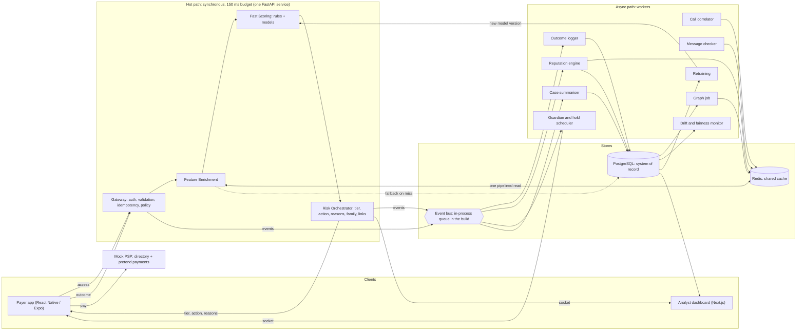
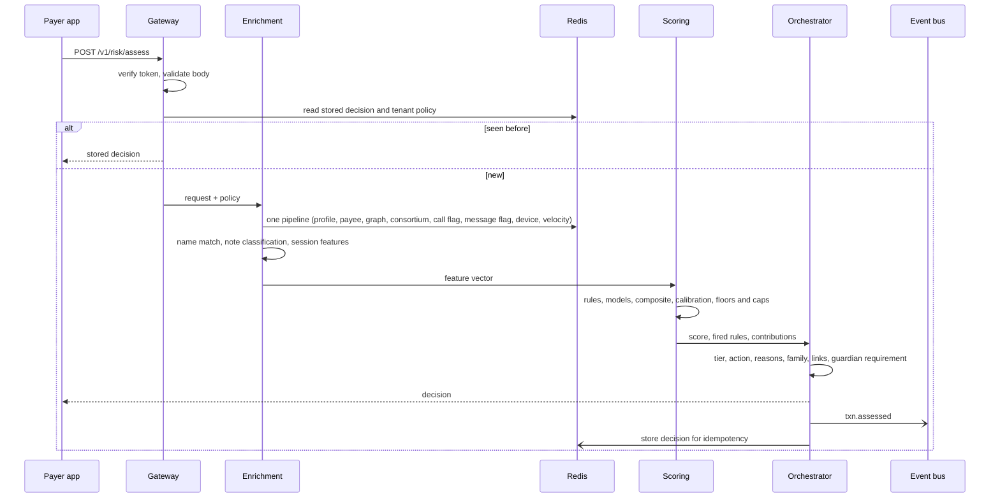
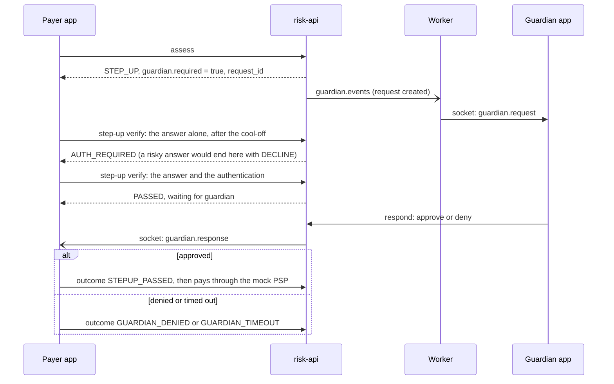

# 04 — Architecture

[← Index](README.md)

The design in this document is what was built, with one difference in how it is run: the build keeps the cache, the event queue and the workers inside the API process on one laptop (section 3.1). Sections marked *planned, not built* describe options the code allows but nobody has run.

## 1. Shape of the system

Two paths, as in the pitch deck.

- The **hot path** is synchronous. It runs between the app asking for a decision and getting one, and has a 150 ms budget.
- The **async path** does everything that can wait: logging, reputation, the network graph, guardian delivery, hold scheduling, monitoring, case summaries, retraining. Nothing on it can delay or fail a payment.

"Gateway" means the entry point of the risk service. It does not process payments. The mock PSP does that, and only pretends to.

## 2. Components

| Component | Responsibility | Runs as |
|---|---|---|
| **Gateway** | Authenticate, validate, idempotency, load tenant policy, enforce the timeout | Module in `risk-api` |
| **Feature Enrichment** | Build the feature vector from Redis, the request and in-process calculations | Module in `risk-api` |
| **Fast Scoring** | Rule engine and models; composite score | Module in `risk-api` |
| **Risk Orchestrator** | Tier, action, reasons, scam family, signal links, guardian requirement | Module in `risk-api` |
| **Call correlator** | Accept call events, write call flags | Router in `risk-api` |
| **Message checker** | Classify pasted messages, extract entities, set message flags | Router in `risk-api` |
| **Product API** | Everything the apps need that is not the hot path: guardians, holds, reports, complaint packs, policy, graph, dashboard reads | Routers in `risk-api` |
| **Outcome logger** | Persist decisions, outcomes and near-misses from events | Worker |
| **Reputation engine** | Decayed counters, bands, consortium publishing | Worker |
| **Graph job** | Rebuild the network and its features every 120 s | Worker; the computation itself in a child process |
| **Guardian and hold scheduler** | Deliver guardian requests, expire them, mark holds ready | Worker |
| **Monitor** | Drift and fairness reports | Worker, on a timer |
| **Case summariser** | Write summaries for Step-Up and Block decisions | Worker |
| **Retraining** | Train, evaluate, register, promote | Script: `python manage.py train` |
| **Mock PSP** | UPI ID directory (registered names) and pretend payment execution | Router in `risk-api` (`/mock-psp/v1/...`) |
| **Simulator** | Generate data, replay traffic | CLI |
| **Payer app** | Demo PSP app | Expo |
| **Dashboard** | Analyst and admin pages | Next.js |

### 2.1 One process for the hot path

The deck draws Gateway, Enrichment, Scoring and Orchestrator as four boxes. They are built as **four modules inside one FastAPI service**, with typed interfaces between them.

Three network hops inside a 150 ms budget would spend a large share of it on serialisation and connections, and four deployables are a lot for four people to run. The diagram stays accurate as a logical view. If scoring ever needs to scale separately, the module boundary is where the service boundary would go.

### 2.2 Workers

All workers live in `services/risk-api/app/workers` and start as asyncio tasks. In the build they run **inside the API process** (`WORKERS_IN_PROCESS=true`), which is the only arrangement that exists: there is no entry point for a separate worker process, and the real-time layer would have to publish through Redis for one to work. They share the API's thread, so the work they do after a decision competes with the next decision for the same processor core. The first load tests showed this plainly, and the logger, the graph job and the drift monitor were each changed to stay out of the way ([section 4.3](#43-latency-budget)). The one exception to "one process" is the graph computation, which the API runs in a child process.

### 2.3 Event bus abstraction

Application code publishes and consumes through one small interface with three implementations:

| Setting | Implementation | Status |
|---|---|---|
| `EVENT_BUS=memory` | An in-process queue with one dispatcher, so events are handled in the order they were published | **Used in the build.** |
| `EVENT_BUS=redis` | Redis Streams with consumer groups | Runs: the acceptance suite passes in this mode on a Redis emulator, in process and over TCP ([10, section 6](10-testing-and-demo.md#the-redis-option)). Not run on a real Redis server. Groups run side by side, so a handler cannot assume another group has already handled the same event. |
| `EVENT_BUS=kafka` | Kafka protocol | Written, never run. Treat as unfinished. |

Topic names are the same in all three.

**The in-process queue is not durable.** An event that has been published but not yet handled is lost if the process stops. The schema has an `outbox` table for writing events before publishing them; the code does not use it yet. For the prototype this means a decision returned in the last moments before a crash may be missing from the dashboard. It never affects what the payer was told.

## 3. Environments

### 3.1 Laptop native (built)

Everything on one laptop, with nothing installed beyond Python and Node. This is the prototype, and every number in [12](12-as-built.md) was measured here.

| Part | How |
|---|---|
| PostgreSQL 16 | From the `pgserver` Python package: started on demand, data in `.data/pg` |
| Cache | `fakeredis` inside the API process. It speaks the Redis commands the code uses, so the same code runs against a real Redis. |
| Event bus | In-process queue |
| API and workers | One `uvicorn` process, `app.main:asgi` |
| Dashboard | `next start`, port 3000 |
| Payer app | Expo dev server: the web build on port 8081, or Expo Go on a phone on the same Wi-Fi |

The cache is empty when the API starts. Start-up rebuilds it from PostgreSQL: profiles, known payees, recent payments, the UPI ID directory, reputation, graph features, guardians, pair blocks and policy. This takes about 5 seconds for the seeded data.

Because the cache lives in one process, only one API process can run in this mode.

### 3.2 Containers (planned, not built)

Docker Compose with PostgreSQL, Redis, Redpanda, the API, a separate worker, the mock PSP and the dashboard. The code takes `DATABASE_URL`, `REDIS_URL` and `EVENT_BUS` for this, but no Compose file was written, there is no separate worker, and only the Redis option has been run, on an emulator. Docker was not running on the build laptop.

### 3.3 Hosted copy (planned, not built)

A public copy on free tiers: Vercel for the two front ends, Render for the API, Neon for PostgreSQL, Upstash for Redis. The team chose a laptop demo, so this was not built. The free-tier limits that would shape it are in [08](08-tech-stack-and-free-services.md).

## 4. The hot path in detail

### 4.1 Assessment sequence

### 4.2 What enrichment reads

One pipelined round trip of 23 commands:

| Key | Gives |
|---|---|
| `decision:{txn_id}` | A decision already made for this `txn_id` (idempotency) |
| `policy:{tenant_id}` | Mode, thresholds, block mode, timers |
| `user_prof:{user_id}` | Payer's account age, phone hash, balance |
| `known_payee:{user_id}` (one field) | Whether and how often the payer has paid this payee, and since when |
| `vel:{user_id}` | Recent payments: times, amounts, payees |
| `dev:{user_id}` (one field) | When this device was first seen |
| `vpa_dir:{vpa_id}` | Registered name, kind, verified, denylist flag, first seen |
| `vpa_rep:{tenant_id}:{vpa_id}` | This bank's decayed counters for the payee |
| `vpa_in:…`, `vpa_in1:…` | Payers, and first-time payers, in the last hour and day |
| `vpa_ev:…:confirmed`, `:report`, `:nearmiss` | Counts of confirmed fraud, reports and near-misses |
| `vpa_graph:{vpa_id}` | Graph features |
| `consortium:{tenant_id}:{vpa_token}` | Other banks' signal |
| `call_flag:{phone_hash}`, `calls_24h:{phone_hash}` | Call context |
| `msg_flag:{user_id}`, `msg_vpas:{user_id}` | Message flag, and UPI IDs named in flagged messages |
| `pair_block:{user_id}:{vpa_id}` | A decline in the last 24 hours for this payer and payee |
| `guardian:{user_id}` | The payer's guardian, mode and threshold |
| `demo_ovr:{user_id}` | Session values set by a staged demo scenario |

Computed in process: amount features, time features, the reputation band, name match, note classification, session features.

If the payee is not in the cache, enrichment loads it from PostgreSQL with a 40 ms timeout and reads again. If the cache itself fails, it builds what it can from PostgreSQL in 40 ms, or uses the documented defaults in [05, section 4](05-data-model.md#4-feature-catalogue-v1), and marks the decision `degraded`.

### 4.3 Latency budget

Measured inside the server at 100 payments a second for 150 seconds ([12, section 4.4](12-as-built.md#44-speed)). This is the best of four runs; in the worst the total was 111 ms at p95.

| Stage | p95 budget | p95 measured |
|---|---|---|
| Read state (one pipelined read) | 10 ms | 12.7 ms |
| Features, including name match and note classification | 26 ms | 0.7 ms |
| Rule engine | 2 ms | 0.04 ms |
| Model inference | 100 ms | 1.5 ms |
| Contributions, reasons and family, only when the tier is not Safe | 12 ms | 1.6 ms at p99 |
| **Decision, total** | **150 ms** | **14.4 ms** |
| Whole request as the client sees it, with HTTP on the same laptop | — | 28 ms |
| PostgreSQL fallback, on a cache miss only | up to 40 ms more | not measured |

Choices that keep the request thread free:

- **Contributions come from XGBoost itself.** Its built-in contribution output gives the same values as the SHAP library's tree explainer without importing that library into the service.
- **Explanations are skipped for Safe decisions**, which need none and are most of the traffic.
- **One payment is scored without scikit-learn's per-call overhead.** The two scikit-learn forests are flattened into arrays at load and walked directly, after checking that this gives the same numbers ([06, section 3](06-risk-engine-and-ml.md#3-models)). Before this, model inference took about 11 ms alone and several times that under load.
- **Nothing is written to PostgreSQL in the hot path.** The decision is published as an event. The logger writes decisions in batches of up to 200, flushing whenever it has caught up and before it handles any other kind of event, so nothing reads a decision that has not been written.
- **Heavy periodic work is kept off the request thread.** The graph is computed in a separate process. The drift monitor has PostgreSQL extract the few values it compares and does its arithmetic in a thread. Large reads are taken a thousand rows at a time.
- **Live-feed notices are sent without waiting for the socket**, and for Safe payments only while the logger is keeping up.
- **Long-lived objects are frozen after start-up**, so the garbage collector does not walk the models and the warmed cache while payments are answered; and the interpreter's thread hand-over interval is 0.5 ms instead of 5 ms.

A decision that takes longer than 300 ms is abandoned and the safe default returned. When more than 48 assessments are already in flight, a new one gets the safe default at once instead of queueing.

## 5. Other request flows

### 5.1 Outcome and feedback

1. The app posts the payer's action to `/v1/risk/outcome`. The gateway publishes `txn.outcome`.
2. The outcome logger writes the `outcomes` row and decides whether it is a near-miss.
3. The reputation engine updates the payee's counters, recomputes the band, writes PostgreSQL and Redis, and publishes `reputation.updated`.
4. The dashboard receives the change over the socket.
5. The next assessment of that payee reads the new values. Target: within 5 s.

### 5.2 Message check

1. The app posts pasted text to `/v1/signals/message`.
2. The service classifies it, extracts entities, and responds with the verdict and highlights. This is not in the payment path; target under 500 ms.
3. If it is a scam: it sets `msg_flag:{user_id}` for 24 hours, upserts `flagged_indicators`, and publishes `msg.checked`.
4. The reputation engine consumes `msg.checked`: when an indicator reaches two distinct reporters, a flagged UPI ID gains a bad event and a flagged phone number is rated a medium-risk caller.

### 5.3 Guardian co-approval

The request ID is generated in the hot path and the row is written by the worker, so the hot path still performs no database write. The worker expires unanswered requests after 10 minutes (2 minutes in demo mode). Co-approval is also required, without a Step-Up, for an allowed or warned first payment at or above the guardian's amount threshold.

### 5.4 Timed hold

1. Assess returns `HOLD` with a `hold_id` and `release_at`. The worker writes `held_payments` from the event and alerts the guardian.
2. The payer may cancel at any time: `POST /v1/holds/{id}/cancel`.
3. The scheduler checks every 3 s. At `release_at` it marks the hold `READY` and sends `hold.ready` to the payer.
4. The payer confirms: `POST /v1/holds/{id}/confirm`. The app then calls assess again with a new `txn_id` and `parent_decision_id`.
5. The orchestrator sees the parent. If the new tier is Block, the action is `DECLINE`; a payment is never held twice.
6. A hold not confirmed within 24 hours becomes `EXPIRED`.

### 5.5 Shadow mode

The gateway loads the tenant's policy. If the mode is `shadow`, the whole pipeline runs and the decision is stored with `enforced = false`, but the response carries `tier = SAFE`, `action = ALLOW`, no reasons and `enforced = false`. No guardian request and no hold is created.

## 6. Real-time channels

Socket.IO, served by `risk-api`.

| Namespace | Who connects | Rooms | Events |
|---|---|---|---|
| `/analyst` | Dashboard | One per tenant | `decision.created`, `outcome.recorded`, `reputation.updated`, `case.summary_ready`, `drift.alert` |
| `/user` | Payer app | One per user | `guardian.request`, `guardian.response`, `guardian.link`, `hold.ready`, `call.incoming`, `call.ended`, `sms.simulated` |

Events are notifications. The apps re-fetch through the REST API when they need the full record, so a missed event loses nothing.

## 7. Failure behaviour

A payment must never be blocked because UPI Inspector is unhealthy.

| Failure | Behaviour | Tested |
|---|---|---|
| Cache unavailable | PostgreSQL fallback with a 40 ms timeout, then default features. Decision marked `degraded`. | Yes, by fault injection (AT-7) |
| A model fails to load or errors | Rules-only decision, marked `degraded`. | Yes (AT-7) |
| Any degraded decision | Tier capped at Warning, unless a hard rule fired: a denylisted payee (R-01), a payee named in a message the payer flagged (R-10), or a first payment to an account with confirmed fraud (R-16). Those rest on evidence, not on the model, and still stop the payment. | Yes (golden G-D1 to G-D4) |
| Decision takes longer than 300 ms | Safe, `degraded: true`, reason `timeout`. | Seen in the first load test |
| More than 48 assessments in flight | Safe, `degraded: true`, reason `overload`, at once. | Not triggered in the tests |
| Process stops with events still queued | Those events are lost; see section 2.3. | No |
| PostgreSQL unavailable | Decisions continue from the cache; workers fail to persist and the failures are counted. Product endpoints return errors. | No |
| Same `txn_id` sent again | The stored decision is returned, for 10 minutes. | Yes (AT-8) |
| Language-model provider unavailable | The next provider is tried; finally the template summary. Decisions are unaffected. | Template only (AT-27) |
| Guardian's app offline | The request waits until it expires. The payment stays unreleased. | Yes (AT-14) |
| Socket disconnected | The payer app polls for a guardian's answer every 3 s and for held payments every 5 s; dashboard pages re-fetch on a timer. | By inspection |

## 8. Configuration and tenancy

- **Tenants.** Two are seeded: `bank_a` and `bank_b`. Every user, UPI ID, payment and decision belongs to one. Staff users see one tenant at a time through the dashboard's switcher.
- **Policy per tenant** (`policy_config`, cached in `policy:{tenant_id}`): mode, the three thresholds, the decline threshold, block mode, hold duration, cool-off duration, guardian timeout.
- **Rules** are one YAML file for all tenants in the prototype.
- **Models** are shared by all tenants.
- **Demo speed.** `DEMO_MODE=true` (the default) shortens the hold to 60 s, the guardian timeout to 2 minutes, the cool-off to 10 s and the never-pay wait to 60 s, and enables the demo endpoints, the API documentation, the overlays and, on the laptop itself, one-click sign-in.

## 9. Security boundaries in the prototype

| Boundary | Mechanism |
|---|---|
| Every request | `app/guard.py` first: host check, body size, per-address rate limit; security headers on the way out |
| Payer app → API | Short-lived signed token (30 minutes, renewed while in use, 12 hours at most) from sign-in with phone and app PIN. One-click demo sign-in only from the laptop itself. Sign-out and a PIN change revoke on the server. |
| Step-Up | A one-time code, or a proof from a phone enrolled with the PIN; three wrong attempts close the challenge |
| PSP → clearance | One payment per decision, within ten minutes of its last approval; only the PSP may report that money moved |
| Dashboard → API | Short-lived signed token (60 minutes, renewed while in use) from staff sign-in with email and password; role (admin, analyst, auditor) checked per endpoint; an admin may switch bank |
| Simulator, mock PSP → API | API key header |
| Demo endpoints | Enabled only when `DEMO_MODE=true`; admin role |
| Language-model calls | Outbound only, tokens in place of identifiers, synthetic data only |

Detail in [11](11-security-risks-and-decisions.md).
