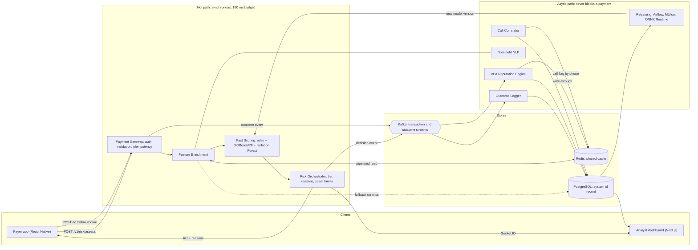

> **Superseded.** This is version 1.0 of the PRD, kept for reference. The current documentation starts at `docs/README.md`.

# UPI Inspector — Product Requirements Document

| | |
|---|---|
| **Product** | UPI Inspector: AI-driven, real-time UPI fraud prevention |
| **Team** | Semicolonist (Atharva Andhare, Sanket Kharche, Tanay Patil, Sharwari Dhandale) |
| **Event** | DECODE SIH 2026, OSCode by communityX |
| **Version** | 1.0 (7 October 2026) |
| **Status** | Draft for build |
| **Source** | Ideation deck, *OSCode - Decode SIH 2026 - Ideation PPT Template* (9 slides) |

**How to read this.** Everything the deck committed to is carried into this document. Where the deck was silent, this PRD makes a decision so the team can start building; those decisions are listed in [Appendix A](#appendix-a-decisions-this-prd-adds-to-the-deck) so they are easy to review and overturn. Numeric targets other than the 150 ms latency budget and the tier thresholds are proposals, not deck commitments.

## Contents

1. [Summary](#1-summary)
2. [Problem and context](#2-problem-and-context)
3. [Goals, non-goals and success metrics](#3-goals-non-goals-and-success-metrics)
4. [Users and user stories](#4-users-and-user-stories)
5. [Scope and phasing](#5-scope-and-phasing)
6. [Product experience](#6-product-experience)
7. [Functional requirements](#7-functional-requirements)
8. [System architecture](#8-system-architecture)
9. [Data design](#9-data-design)
10. [Risk engine specification](#10-risk-engine-specification)
11. [Data and ML plan](#11-data-and-ml-plan)
12. [API contract](#12-api-contract)
13. [Tech stack](#13-tech-stack)
14. [Repository layout and local setup](#14-repository-layout-and-local-setup)
15. [Build plan from scratch](#15-build-plan-from-scratch)
16. [Testing and acceptance](#16-testing-and-acceptance)
17. [Security, privacy and compliance](#17-security-privacy-and-compliance)
18. [Deployment and operations](#18-deployment-and-operations)
19. [Demo script](#19-demo-script)
20. [Risks and mitigations](#20-risks-and-mitigations)
21. [Open questions](#21-open-questions)
22. [Business model and path to pilot](#22-business-model-and-path-to-pilot)
- [Appendix A: Decisions this PRD adds to the deck](#appendix-a-decisions-this-prd-adds-to-the-deck)
- [Appendix B: Fixes to make in the deck](#appendix-b-fixes-to-make-in-the-deck)
- [Appendix C: References](#appendix-c-references)

---

## 1. Summary

UPI Inspector is a risk-decisioning layer that a bank or UPI app calls just before a payment is authorised. It scores the payment, the payee and the payer's situation together, including whether a suspicious call came just before the payment, and returns one of four responses: **Safe**, **Warning**, **Step-Up** or **Block**. Every response above Safe carries a plain-language reason and the name of the scam pattern the payment resembles.

It works alongside existing bank and PSP infrastructure and does not move money itself.

The fraud it targets is social engineering: fake refunds, "digital arrest", impersonation and mule transfers. In these scams the real account holder makes the payment willingly, so checks that only confirm the payer's identity pass. The product's bet is that the manipulation leaves evidence around the payment (a call from a risky number, a brand-new payee collecting from many strangers, an amount far outside the payer's habits) and that combining that evidence at the moment of payment lets us intervene before the money leaves.

This document defines what to build for the hackathon prototype, how to build it from an empty repository, and what changes for a bank pilot.

## 2. Problem and context

### 2.1 The problem

From the deck:

- **Reactive only.** Today's systems act after the loss. There is no real-time hold at the point of payment.
- **No correlation.** Nothing links the scam call or SMS to the transaction that follows it.
- **Scores without reasons.** Risk systems emit a confidence score with no explanation a payer or a regulator can read.
- **Silos.** Banks, telecom operators and platforms each see one part of the event.

### 2.2 Who is affected

| Group | How they are hit |
|---|---|
| Citizens and families | Panic-driven transfers during a scam call |
| Elderly users | Targeted disproportionately by digital-arrest scams |
| Small businesses | Boss or vendor impersonation that ends in a UPI payment |
| Law enforcement | No tool to trace a scam call to the transaction it caused |

### 2.3 Why now

- **Every P2P payment is now payer-initiated.** NPCI discontinued P2P collect requests from 1 October 2025. A scammer can no longer pull money with a request; they have to persuade the payer to push it. That is the case this product is built for.
- **A regulator-backed phone-risk signal exists.** The Department of Telecommunications launched the Financial Fraud Risk Indicator (FRI) in May 2025, which classifies mobile numbers into three risk levels, and an RBI advisory of 30 June 2025 directed banks to integrate it. This is the production source for the "risky caller" signal that the prototype simulates.
- **Shared fraud intelligence is being built.** RBI's Digital Payments Intelligence Platform (DPIP, built by the Reserve Bank Innovation Hub) is a shared fraud-intelligence platform and fraud-account repository, and MuleHunter.AI scores accounts for mule behaviour. The deck positions UPI Inspector as complementary: those work at the registry and account level, while UPI Inspector acts on a single payment at the moment it is made and can consume both as inputs.
- **Explainability is expected.** RBI's FREE-AI committee report (13 August 2025) sets out principles for AI in finance that include explainability and human oversight. A fraud block has to be justifiable to the user and to the regulator.

## 3. Goals, non-goals and success metrics

### 3.1 Goals

| # | Goal |
|---|---|
| G1 | Decide on every payment inside the payment flow, within a 150 ms synchronous budget. |
| G2 | Score transaction, payee trust and payer behaviour together in one decision. |
| G3 | Correlate call signals with the payment that follows and record them as one connected risk event. |
| G4 | Attach a plain-language reason and a named scam pattern to every flag. |
| G5 | Respond in proportion to risk, so that safe payments see no friction. |
| G6 | Learn from outcomes: confirmed fraud and near-misses update payee reputation and retrain the models. |

### 3.2 Non-goals

- Replacing a bank's or PSP's existing fraud risk management system. UPI Inspector adds a layer.
- Moving money or holding funds. The PSP executes or declines the payment based on our response.
- Detecting account takeover as a primary use case. Device signals are included, but the product is tuned for scams where the genuine user pays.
- Recording or analysing call audio or message content from the user's phone. Only call metadata and a risk flag are used.
- Post-transaction recovery, chargebacks or dispute resolution.
- Live NPCI or bank data in the prototype. The prototype runs on synthetic transactions and simulated call signals.

### 3.3 Success metrics for the prototype

All detection figures are measured on a held-out synthetic test set (section 11). They show that the pipeline works, not how it would perform on real traffic. Say so when presenting them.

| Metric | Target | How measured |
|---|---|---|
| Hot-path latency | p95 ≤ 150 ms, p99 ≤ 250 ms at 200 requests/s on one 4-vCPU node | Server-side histogram from gateway entry to response |
| Scam recall at Step-Up or Block | ≥ 85% | Held-out scam scenarios |
| Recall on unseen scam variants | ≥ 70% | Scenario variants excluded from training |
| Legitimate payments sent to Step-Up or Block | ≤ 1% | Held-out legitimate transactions |
| Legitimate payments sent to Block | ≤ 0.1% | Same |
| Legitimate payments shown a Warning | ≤ 5% | Same |
| Explanation coverage | 100% of non-Safe decisions carry at least one reason code | Automated check on every decision |
| Scam-family attribution accuracy | ≥ 80% top-1 | Labelled scam scenarios |
| Call-to-payment linkage | ≥ 95% of scam payments preceded by a flagged call are linked in the dashboard | Scenario replay |
| Feedback latency | Payee reputation reflects a confirmed report within 5 s | End-to-end timer on the async path |
| Degraded-mode safety | 0 payments blocked because a dependency was down | Chaos test (section 16) |

## 4. Users and user stories

### 4.1 Personas

| Persona | Needs |
|---|---|
| **Payer** | Pay quickly when things are normal. Be stopped, with a reason they can understand under stress, when they are being scammed. |
| **Elderly payer** | Large text, one clear instruction, their own language, no jargon. |
| **Small-business owner or accountant** | Protection when a payment request claims to come from the boss or a vendor. |
| **Fraud analyst at a bank or PSP** | A live feed of decisions, the evidence behind each one, and a way to confirm fraud or mark a false positive. |
| **Integration engineer at a bank or PSP** | One API call with a stable contract, a hard latency ceiling, and predictable behaviour when our service is down. |
| **Investigator (pilot phase)** | An export linking a scam call to the payment it caused. |

### 4.2 User stories

| ID | Story | Phase |
|---|---|---|
| US-1 | As a payer, I see a trust indicator for a payee as soon as I enter their UPI ID, before I type an amount. | P0 |
| US-2 | As a payer making a normal payment, I see no extra screens. | P0 |
| US-3 | As a payer making a risky payment, I see why it is risky in one or two sentences, in my language. | P0 |
| US-4 | As a payer being coached by a scammer on a call, I am told which scam this looks like and what the scammer is likely saying to me. | P0 |
| US-5 | As a payer at Step-Up, I am made to pause and answer one question before I can continue. | P1 |
| US-6 | As a payer who was blocked wrongly, I can report that and get a human review. | P1 |
| US-7 | As an analyst, I see decisions arrive live with tier, score, reasons and scam family. | P0 |
| US-8 | As an analyst, I can open a decision and see the call and the payment on one timeline. | P1 |
| US-9 | As an analyst, I can confirm fraud or mark a false positive, and that label feeds reputation and retraining. | P1 |
| US-10 | As an integration engineer, I get a decision or a safe default within a fixed timeout, every time. | P0 |
| US-11 | As a payer, I can rehearse a simulated scam so I recognise the real one. | P2 |
| US-12 | As an investigator, I can export a call-to-payment linkage report for a case. | P2 |

## 5. Scope and phasing

Three phases. **P0** is the smallest thing that demonstrates the idea end to end. **P1** makes it finals-ready. **P2** is what a single-bank pilot needs.

| Capability | P0 demo MVP | P1 hardening | P2 pilot |
|---|---|---|---|
| Risk API with tiered response | Yes | Idempotency, degraded mode, rate limits | Multi-tenant, SLAs |
| Rule engine | 6 core rules | Full rule set, hot reload | Per-bank rule packs |
| ML scoring | XGBoost only | + Random Forest, Isolation Forest, calibrated stacker | Champion/challenger in production |
| Payee reputation | Decayed counters, shown before payment | Report weighting, anti-poisoning | DPIP and MuleHunter.AI inputs |
| Call correlation | Simulated telecom API | Twilio Voice webhooks for a live demo call | DoT FRI via the bank, on-device call state with consent |
| Note-field NLP | TF-IDF + logistic regression | DistilBERT (multilingual) on ONNX | Continuous fine-tuning |
| Explainability | Rule hits + SHAP reason codes | Evidence values, Hindi copy | Regulator-facing audit export |
| Scam-family attribution | 4 families | 6 families, learned prototypes | Taxonomy governance |
| Payer app | React Native demo PSP app, four tier screens | Step-up flow with cool-off, question and OTP | SDK for PSP apps |
| Analyst dashboard | Live feed, decision detail | Linked timeline, case actions, near-miss feed, metrics | Roles, tenant isolation, exports |
| Feedback loop | Outcomes logged | Live reputation deltas, retraining job, model hot swap | Airflow-scheduled, gated promotion |
| Scam rehearsal simulation | No | No | Yes |
| Observability | Latency histogram, tier counts | Prometheus + Grafana dashboards, alerts | On-call runbooks |

### 5.1 What is real and what is simulated in the prototype

| Component | Prototype | Production equivalent |
|---|---|---|
| Transactions | Synthetic, from the simulator | Bank or PSP transaction stream |
| Payment execution | Mock PSP service (optionally a provider's UPI test mode) | The PSP's own switch |
| Call signals | Simulated telecom API; Twilio Voice status webhooks for a staged call | DoT FRI through the bank, plus consented on-device call state |
| Payee denylist | Seeded table | DPIP negative registry, bank's own lists |
| Fraud labels | Injected by the simulator, plus analyst clicks | Confirmed complaints (1930, bank disputes) |
| Balance | Simulated | Available only when deployed inside the bank or PSP |

## 6. Product experience

### 6.1 Payer flow

1. The payer enters or scans a UPI ID. The app calls the reputation endpoint and shows a **payee reputation chip** next to the name (section 6.5).
2. The payer enters the amount and an optional note and taps Pay.
3. The app calls the risk API **before** the UPI PIN screen.
4. The app renders the response for the returned tier.
5. The app reports what the payer did (proceeded, backed out, passed or abandoned step-up) to the outcome endpoint.

### 6.2 Tiered response

Thresholds are from the deck. Ranges are half-open so that every score maps to exactly one tier.

| Tier | Score | What the payer sees | What the payer must do | Logged outcome |
|---|---|---|---|---|
| **Safe** | below 0.30 | Nothing. Straight to the PIN screen. | Nothing | `PROCEEDED` |
| **Warning** | 0.30 to below 0.60 | Inline banner above the Pay button with the top reason. | Choose Continue or Cancel. | `PROCEEDED` or `ABORTED` |
| **Step-Up** | 0.60 to below 0.85 | Modal that interrupts the flow: scam pattern, reasons, a pause, one question, then additional authentication. | Complete all steps, or cancel. | `STEPUP_PASSED`, `STEPUP_ABANDONED` |
| **Block** | 0.85 and above | Full-screen stop. The payment cannot continue. | Nothing to do in this flow. Recourse is in 6.4. | `BLOCKED` |

### 6.3 Step-Up design

In a social-engineering scam the genuine account holder is the one paying, so asking them to prove who they are does not stop the payment: a coached victim will enter the OTP. Step-Up therefore has two jobs, and the first matters more.

1. **Break the scammer's script.** Show the named pattern and what the scammer is probably saying ("Police and courts never ask for money over UPI or keep you on a call"). Enforce a cool-off timer (30 s by default, configurable). Ask one pattern-specific question ("Is someone on a call telling you to make this payment?"). Answering "yes" escalates to Block.
2. **Authenticate again.** OTP to the registered number or device biometric. This covers the cases where the device or session is suspect.

### 6.4 Block and recourse

The deck specifies a full-screen stop with no path forward, and the payment attempt ends there. Because any model produces false positives, the Block screen also carries:

- the reasons and the scam pattern,
- the national cybercrime helpline (1930) and a one-tap "call my bank",
- a **"This is not a scam"** link that files a review request for an analyst.

The same payer-to-payee pair stays blocked for a cooling period (24 hours by default). Whether a pilot bank wants a hard block or a timed hold is an open question (section 21).

### 6.5 Payee reputation chip

Shown as soon as a UPI ID is resolved, before the amount is entered.

| Band | Meaning | Display |
|---|---|---|
| Trusted | Long, clean history | Green tick, "Established payee" |
| Neutral | Some history, nothing adverse | No emphasis |
| No history | New or rarely used UPI ID | Grey, "Little or no payment history" |
| Caution | Unusual recent activity or unconfirmed reports | Amber, one-line reason |
| Reported | Confirmed fraud reports | Red, "Reported for fraud" |

"No history" is deliberately neutral. A new shop is not a scammer, and the chip must not say so.

### 6.6 Messages adapt to the scam pattern

The deck's differentiator is that the message is specific to the pattern, not a generic alert. Each scam family in the taxonomy (section 10.9) owns its copy. Examples:

| Family | Headline | Body |
|---|---|---|
| Digital arrest | "This looks like a 'digital arrest' scam" | "Police, CBI and courts never ask for money over UPI and never keep you on a call. Hang up. Call 1930." |
| Fake refund | "You are about to PAY money, not receive it" | "No one needs your UPI PIN or a payment from you to send you a refund." |
| Mule transfer | "This UPI ID is collecting money from many strangers" | "It was created recently and has received payments from 37 new people in the last hour." |
| Impersonation | "Check this request with the person directly" | "You have never paid this UPI ID before. Call your manager or vendor on a number you already have." |

Reasons are shown as a short list (maximum three), each a full sentence with the evidence in it ("8 times larger than your usual payment"), never a bare code or a score.

Copy ships in English and Hindi in P1. The message catalogue is data, so more languages are a content task, not a code change.

### 6.7 Analyst dashboard

| View | Contents | Phase |
|---|---|---|
| Live feed | Decisions as they happen: time, amount, payee, tier, score, top reason, scam family. Pushed over Socket.IO. | P0 |
| Decision detail | Feature contributions (SHAP waterfall), fired rules, payee reputation history, model and rules versions. | P0 |
| Linked risk event | One timeline showing the call event(s) and the payment they preceded. | P1 |
| Near-miss feed | Payments the payer abandoned after a Warning or Step-Up. | P1 |
| Case actions | Confirm fraud, mark false positive, add note. Writes labels. | P1 |
| Payee lookup | Search a UPI ID, see reputation, counters and history. | P1 |
| Health | Latency percentiles, tier distribution, degraded-mode count, cache hit rate, active model version. | P1 |
| Demo control | Trigger a scenario or a staged scam call. Prototype only. | P0 |

### 6.8 Scam rehearsal simulation (planned, P2)

A 60 to 90 second interactive simulation of a scam conversation matched to a family. The user picks responses and is shown where the manipulation happened. Offered proactively to at-risk segments, and as an optional "see how this scam works" link from a Step-Up or Block screen. It never gates a payment.

## 7. Functional requirements

### Gateway

- **FR-GW-1** Expose `POST /v1/risk/assess` and return a decision or a safe default within a hard timeout of 300 ms.
- **FR-GW-2** Authenticate callers with OAuth client credentials (machine-to-machine JWT).
- **FR-GW-3** Be idempotent on `txn_id`: a repeated request returns the stored decision.
- **FR-GW-4** Validate input against the published schema and reject malformed requests with a 4xx, never a default "Safe".
- **FR-GW-5** Emit a latency histogram per stage and per request.

### Feature enrichment

- **FR-ENR-1** Fetch payer profile, payer-payee relationship, payee reputation, device and call context from Redis in one pipelined round trip.
- **FR-ENR-2** On a cache miss, fall back to PostgreSQL with a 40 ms timeout, then repopulate the cache.
- **FR-ENR-3** If both fail, use documented default values and mark the decision `degraded`.
- **FR-ENR-4** Return a feature vector that conforms to the versioned feature schema.

### Payee reputation engine

- **FR-REP-1** Consume transaction, outcome and report events from Kafka and maintain time-decayed counters per UPI ID.
- **FR-REP-2** Write the result to `vpa_rep:{vpa_id}` in Redis (write-through) and to PostgreSQL.
- **FR-REP-3** Serve `GET /v1/payee/{vpa}/reputation` for the pre-payment chip.
- **FR-REP-4** Weight reports by reporter credibility and rate-limit them so a UPI ID cannot be defamed by mass reporting.

### Call correlator

- **FR-CALL-1** Accept call events from the simulated telecom API and, in P1, from Twilio Voice status webhooks with signature verification.
- **FR-CALL-2** Write `call_flag:{phone_hash}` to Redis with a TTL equal to the correlation window, and persist the event to PostgreSQL.
- **FR-CALL-3** Never receive or store call audio or content.

### Note-field NLP

- **FR-NLP-1** Classify the transaction note (from a QR code, payment link or merchant collect request) into scam-language classes and return a probability.
- **FR-NLP-2** Stay within a 25 ms p95 budget in the hot path. If a heavier model cannot, run it asynchronously and cache by text hash.

### Fast scoring

- **FR-SC-1** Evaluate the deterministic rule set and return fired rules with floors, caps and bumps.
- **FR-SC-2** Run the supervised and unsupervised models and return a composite, calibrated score in [0, 1].
- **FR-SC-3** Load models by version and switch versions without a restart.

### Risk orchestrator

- **FR-ORC-1** Map the score to a tier using the configured thresholds.
- **FR-ORC-2** Produce up to three reason codes for every non-Safe decision, each with evidence values.
- **FR-ORC-3** Attribute the decision to a scam family, or to "unclassified suspicious" when no family is close enough.
- **FR-ORC-4** When call features contributed to the decision, link the call event(s) to the decision as one risk event.
- **FR-ORC-5** Publish the decision event to Kafka and push it to the dashboard over Socket.IO, both without blocking the response.

### Response and outcome

- **FR-RESP-1** Return tier, action, reasons, scam family, payee reputation and step-up requirements in one response.
- **FR-RESP-2** Accept `POST /v1/risk/outcome` with the payer's action and the final payment status.
- **FR-LOG-1** Write every decision and outcome to the transaction ledger.
- **FR-LOG-2** Record a near-miss when a payer abandons a payment after a Warning or Step-Up.

### Feedback and retraining

- **FR-TRAIN-1** Retrain on confirmed fraud and near-miss records on a schedule (daily or hourly).
- **FR-TRAIN-2** Promote a new model only if it passes evaluation gates against the current model on a frozen test set.
- **FR-TRAIN-3** Recalculate reputation deltas and scam-family prototypes in the same pipeline.
- **FR-TRAIN-4** Run on a private network with row-level access control, isolated from the hot path.

## 8. System architecture

### 8.1 Overview

Two paths, as in the deck. The **hot path** is synchronous and has the 150 ms budget. The **async path** does everything that can wait: logging, reputation updates, retraining. Nothing on the async path can delay or fail a payment.



"Payment Gateway" here means the entry point of the risk service. It does not process payments.

### 8.2 Components

| Component | Responsibility | Tech |
|---|---|---|
| Payment Gateway | Auth, validation, idempotency, timeout, orchestration of the hot path | FastAPI |
| Feature Enrichment | Assemble the feature vector from Redis, with PostgreSQL fallback | FastAPI module, redis-py asyncio |
| Fast Scoring | Rule engine and ML models | XGBoost, scikit-learn, ONNX Runtime |
| Risk Orchestrator | Tier mapping, SHAP reason codes, scam-family attribution | SHAP, NumPy |
| VPA Reputation Engine | Decayed counters per UPI ID | Kafka consumer |
| Call Correlator | Ingest call events, write call flags | FastAPI, Twilio webhooks |
| Note-field NLP | Classify note text | scikit-learn, then DistilBERT on ONNX |
| Outcome Logger | Persist decisions, outcomes and near-misses | Kafka consumer |
| Retraining pipeline | Train, evaluate, register, promote | Airflow, MLflow |
| Payer app | Demo PSP app with tier UX | React Native (Expo) |
| Dashboard | Analyst views | Next.js, Socket.IO client |
| Observability | Metrics and dashboards | Prometheus, Grafana |

### 8.3 One process for the hot path

The deck draws Gateway, Enrichment, Scoring and Orchestrator as four boxes. Build them as **four modules inside one FastAPI service** for P0 and P1, with the interfaces between them defined as typed function contracts.

Three network hops inside a 150 ms budget would spend a large share of it on serialisation and connection overhead, and four deployables are a lot for a four-person team to run. The diagram stays accurate as a logical view. If scoring needs to scale separately in a pilot, the module boundary is already where the service boundary would go.

The reputation worker, call correlator, outcome logger and retraining job are separate processes from day one because they are genuinely asynchronous.

### 8.4 Latency budget

| Stage | p95 budget |
|---|---|
| Auth, validation, idempotency check | 5 ms |
| Redis pipelined read | 10 ms |
| Note NLP (cached or lightweight model) | 25 ms |
| Rule engine | 2 ms |
| Model inference (XGBoost, RF, Isolation Forest) | 10 ms |
| SHAP and attribution, only when score ≥ 0.30 | 15 ms |
| Serialisation and network | 20 ms |
| **Total** | **about 90 ms**, leaving headroom under 150 ms |
| PostgreSQL fallback, on a cache miss only | up to 40 ms more |

SHAP is skipped for Safe decisions. They need no explanation, and they are the large majority of traffic.

### 8.5 Failure behaviour

A payment must never be blocked because UPI Inspector is unhealthy.

| Failure | Behaviour |
|---|---|
| Redis unavailable | PostgreSQL fallback with a 40 ms timeout, then default features. Decision marked `degraded`. |
| Model fails to load or errors | Rules-only decision, marked `degraded`. |
| Any degraded decision | Tier capped at Warning, unless the payee is on the confirmed-fraud denylist. |
| Hot path exceeds 300 ms | Gateway returns a rules-only decision if available, otherwise Safe with `degraded: true`. |
| Kafka unavailable | Decision is still returned. Events are buffered to a local outbox table and replayed. |
| Caller sends the same `txn_id` again | Stored decision is returned. |

## 9. Data design

PostgreSQL is the system of record. Redis is a cache that can be rebuilt from PostgreSQL and Kafka at any time.

### 9.1 PostgreSQL schema (core tables)

```sql
CREATE TABLE users (
  user_id        uuid PRIMARY KEY,
  phone_hash     text UNIQUE NOT NULL,      -- HMAC of the phone number, never the number
  segment        text,                      -- used by the simulator
  locale         text DEFAULT 'en',
  created_at     timestamptz NOT NULL DEFAULT now()
);

CREATE TABLE devices (
  device_id      uuid PRIMARY KEY,
  user_id        uuid REFERENCES users,
  fingerprint    text NOT NULL,
  first_seen     timestamptz NOT NULL,
  last_seen      timestamptz NOT NULL
);

CREATE TABLE vpas (
  vpa_id         text PRIMARY KEY,          -- e.g. name@bank
  kind           text NOT NULL,             -- person | merchant
  verified       boolean DEFAULT false,
  first_seen     timestamptz NOT NULL
);

CREATE TABLE vpa_reputation (
  vpa_id         text PRIMARY KEY REFERENCES vpas,
  recv_decayed   double precision NOT NULL DEFAULT 0,
  bad_decayed    double precision NOT NULL DEFAULT 0,
  reports_30d    integer NOT NULL DEFAULT 0,
  confirmed_90d  integer NOT NULL DEFAULT 0,
  near_miss_14d  integer NOT NULL DEFAULT 0,
  fan_in_1h      integer NOT NULL DEFAULT 0,
  fan_in_24h     integer NOT NULL DEFAULT 0,
  p_bad          double precision NOT NULL,
  trust_score    smallint NOT NULL,         -- 0..100, for display
  band           text NOT NULL,
  updated_at     timestamptz NOT NULL
);

CREATE TABLE transactions (
  txn_id         text PRIMARY KEY,
  user_id        uuid REFERENCES users,
  payer_vpa      text NOT NULL,
  payee_vpa      text NOT NULL REFERENCES vpas,
  amount         numeric(12,2) NOT NULL,
  origin         text NOT NULL,             -- manual | contact | qr | intent_link | merchant_collect
  note           text,
  device_id      uuid,
  created_at     timestamptz NOT NULL
);

CREATE TABLE risk_decisions (
  decision_id    uuid PRIMARY KEY,
  txn_id         text UNIQUE REFERENCES transactions,
  score          double precision NOT NULL,
  tier           text NOT NULL,             -- SAFE | WARNING | STEP_UP | BLOCK
  reason_codes   text[] NOT NULL DEFAULT '{}',
  rules_fired    text[] NOT NULL DEFAULT '{}',
  scam_family    text,
  family_sim     double precision,
  features       jsonb NOT NULL,            -- exact feature vector used; training reads this
  model_version  text NOT NULL,
  rules_version  text NOT NULL,
  degraded       boolean NOT NULL DEFAULT false,
  latency_ms     integer NOT NULL,
  created_at     timestamptz NOT NULL DEFAULT now()
);

CREATE TABLE outcomes (                     -- the transaction ledger
  decision_id    uuid PRIMARY KEY REFERENCES risk_decisions,
  user_action    text NOT NULL,             -- PROCEEDED | ABORTED | STEPUP_PASSED | STEPUP_ABANDONED | BLOCKED
  final_status   text,                      -- SUCCESS | FAILED | NOT_ATTEMPTED
  is_near_miss   boolean NOT NULL DEFAULT false,
  created_at     timestamptz NOT NULL DEFAULT now()
);

CREATE TABLE call_events (
  call_id        uuid PRIMARY KEY,
  callee_hash    text NOT NULL,
  caller_hash    text NOT NULL,
  caller_risk    smallint NOT NULL,         -- 0 none, 1 medium, 2 high, 3 very high
  caller_known   boolean NOT NULL,
  started_at     timestamptz NOT NULL,
  ended_at       timestamptz,
  source         text NOT NULL              -- simulated | twilio | device
);

CREATE TABLE risk_event_links (             -- "one connected risk event"
  decision_id    uuid REFERENCES risk_decisions,
  call_id        uuid REFERENCES call_events,
  PRIMARY KEY (decision_id, call_id)
);

CREATE TABLE fraud_reports (
  report_id      uuid PRIMARY KEY,
  txn_id         text REFERENCES transactions,
  payee_vpa      text NOT NULL,
  reporter_id    uuid,
  status         text NOT NULL,             -- REPORTED | CONFIRMED | REJECTED
  family         text,
  created_at     timestamptz NOT NULL DEFAULT now()
);

CREATE TABLE scam_families (
  code           text PRIMARY KEY,
  name           text NOT NULL,
  prototype      double precision[] NOT NULL,   -- vector in signal space
  messages       jsonb NOT NULL,                -- per-locale headline, body, question
  active         boolean NOT NULL DEFAULT true
);

CREATE TABLE reason_codes (
  code           text PRIMARY KEY,
  signal_group   text NOT NULL,
  templates      jsonb NOT NULL                 -- per-locale sentence with {placeholders}
);

CREATE TABLE audit_log (                    -- append-only
  id             bigserial PRIMARY KEY,
  actor          text NOT NULL,
  action         text NOT NULL,
  subject        text NOT NULL,
  detail         jsonb,
  created_at     timestamptz NOT NULL DEFAULT now()
);
```

Storing the exact feature vector on every decision is what keeps training and serving consistent: the retraining job reads the features that were actually used, so there is no second feature pipeline to drift.

### 9.2 Redis keys

| Key | Type | Contents | TTL |
|---|---|---|---|
| `vpa_rep:{vpa_id}` | hash | Reputation counters, `p_bad`, `trust_score`, `band`, age | 24 h, refreshed on write |
| `call_flag:{phone_hash}` | hash | `state`, `caller_risk`, `caller_known`, `started_at`, `ended_at` | Correlation window (30 min after call end) |
| `user_prof:{user_id}` | hash | 30-day mean, std and p95 of amount, transaction counts, first-seen date | 24 h |
| `known_payee:{user_id}` | hash | payee → count and first-paid date | 30 days |
| `vel:{user_id}` | sorted set | Recent payment timestamps for velocity windows | 24 h |
| `dev:{user_id}` | set | Known device IDs | 90 days |
| `decision:{txn_id}` | string | Serialised decision, for idempotency | 10 min |
| `model:active` | string | Active model version pointer | none |

### 9.3 Kafka topics

| Topic | Producer | Consumers |
|---|---|---|
| `txn.assessed` | Risk orchestrator | Outcome logger, reputation engine, dashboard bridge |
| `txn.outcome` | Gateway | Outcome logger, reputation engine |
| `call.events` | Call correlator | Outcome logger |
| `fraud.reports` | Dashboard, payer app | Reputation engine |
| `sim.transactions` | Simulator | Replay driver for demos and load tests |

### 9.4 Feature catalogue (v1)

| Group | Features |
|---|---|
| Transaction | `amount`, `log_amount`, `hour_of_day`, `day_of_week`, `origin`, `is_merchant`, `has_note` |
| Payer behaviour | `amount_z`, `amount_over_p95`, `txn_count_1h`, `txn_count_24h`, `new_payees_24h`, `account_age_days`, `balance_fraction` (when available) |
| Payer-payee relationship | `is_new_payee`, `prior_txn_count`, `days_since_first_paid` |
| Payee reputation | `vpa_age_days`, `p_bad`, `maturity`, `fan_in_1h`, `fan_in_24h`, `first_time_payer_ratio_24h`, `reports_30d`, `confirmed_90d`, `near_miss_14d`, `is_verified_merchant` |
| Device and session | `device_is_new`, `device_age_days`, `session_age_s` |
| Call context | `call_active`, `mins_since_call_end`, `call_duration_s`, `caller_unknown`, `caller_risk`, `unknown_calls_24h` |
| Note NLP | `note_scam_prob`, `note_label` |

## 10. Risk engine specification

### 10.1 Rule engine

Rules are deterministic, versioned in a YAML file, and hot-reloadable. Each rule can set a **floor** (score cannot go below), a **cap** (score cannot go above) or a **bump** (added to the rule score). Starting set:

| ID | Condition | Effect | Phase |
|---|---|---|---|
| R01 | Payee is on the confirmed-fraud denylist | Floor 0.90 | P0 |
| R02 | Caller risk is "very high", call active or ended under 10 minutes ago, and payee is new | Floor 0.85 | P0 |
| R03 | New payee, amount over 5× the payer's 30-day p95, and a call with an unknown number is active | Floor 0.60 | P0 |
| R04 | Payee UPI ID under 7 days old with a spike of first-time payers in the last hour | Bump 0.25 | P0 |
| R05 | Device first seen under 24 hours ago, new payee, amount over ₹10,000 | Floor 0.60 | P0 |
| R06 | Three or more payments to new payees within 10 minutes | Bump 0.20 | P1 |
| R07 | Note text classified as scam language with probability ≥ 0.8 | Bump 0.15 | P0 |
| R08 | Payment would use 80% or more of the balance (when known) | Bump 0.15 | P1 |
| R09 | Payee paid at least 3 times over at least 30 days, with no reports | Cap 0.29 (unless R01 fires) | P0 |

R09 protects the "no friction for safe payments" promise: paying your landlord again should never produce a warning. All numeric thresholds are starting values to tune on the validation set.

### 10.2 Models

| Layer | Model | Purpose |
|---|---|---|
| Supervised | XGBoost (champion) | Main fraud probability. Also the model SHAP explains. |
| Supervised | Random Forest | Second opinion, soft-voted with XGBoost for stability. |
| Unsupervised | Isolation Forest | Flags payments unlike anything seen, for scam patterns not in the training labels. |
| Text | TF-IDF + logistic regression, then DistilBERT | Scam-language probability for the note field. Feeds the supervised models as a feature. |

Per the deck, interpretability is preferred over the last fraction of accuracy. Keep trees shallow and the feature set small enough to explain.

### 10.3 Composite score

```
s_ml    = 0.7 * p_xgboost + 0.3 * p_random_forest
s_anom  = isolation-forest score mapped to [0, 1] by its quantile among legitimate payments
s_rule  = min(1, sum of rule bumps)

raw     = sigmoid(b0 + b1 * logit(s_ml) + b2 * s_anom + b3 * s_rule)   # stacker fitted on a validation fold
score   = isotonic_calibration(raw)
score   = min(cap, max(floor, score))                                   # rule floors and caps applied last
```

For P0, before the stacker exists, use fixed weights: `0.65 * s_ml + 0.15 * s_anom + 0.20 * s_rule`, then floors and caps.

### 10.4 Tier mapping and calibration

The thresholds 0.30, 0.60 and 0.85 only mean something if the score is calibrated, so that 0.85 really does correspond to a very high fraud probability. Calibrate with isotonic regression on a held-out fold, and check that the share of legitimate payments landing in each tier is within the budgets in section 3.3. If it is not, recalibrate; do not move the thresholds, since they are part of the product's public behaviour. Thresholds live in config per tenant for the pilot.

### 10.5 Payee reputation

Each counter is decayed exponentially so recent activity weighs more than old activity:

```
C(t) = C(t_prev) * 2^(-(t - t_prev) / half_life) + x
```

| Counter | Increment | Half-life |
|---|---|---|
| `recv` | 1 per inbound payment | 30 days |
| `bad` | 5 per confirmed fraud, 1 per credible report, 0.3 per near-miss | 30 days |

Both counters share one half-life on purpose. If inbound payments decayed faster than bad events, the bad-event rate of a UPI ID that went quiet would climb on its own with no new evidence.

From those:

```
p_bad       = (0.5 + bad) / (50 + recv)              # smoothed rate, prior mean 1%
maturity    = 1 - exp(-recv / 20)                    # how much history backs the estimate
trust_score = round(100 * (1 - min(1, p_bad / 0.10)) * (0.5 + 0.5 * maturity))
```

Bands, evaluated in this order:

1. **Reported** if there is a confirmed fraud in the last 90 days, or `p_bad` ≥ 10%.
2. **Caution** if `p_bad` is between 2% and 10%.
3. **No history** if the UPI ID was first seen under 30 days ago, or has received fewer than 3 payments in total.
4. **Trusted** if it has no bad events in the window, `maturity` ≥ 0.8, and is at least 90 days old. In practice this is established merchants.
5. **Neutral** otherwise. Most personal UPI IDs sit here: some history, nothing adverse, not enough volume to call established.

A brand-new UPI ID scores around 45 and shows "No history", not a warning. Risk comes from the combination with other signals, not from newness alone. Whether a payee is familiar *to this payer* is a separate signal, handled by the payer-payee relationship features and rule R09.

Fan-in counters (`fan_in_1h`, `fan_in_24h`, first-time payer ratio) are sliding windows, not decayed, because the mule pattern is a burst.

**Protection against abuse.** Reports only count from users who actually paid that UPI ID, are rate-limited per reporter, and are weighted by the reporter's history. The "Reported" band requires analyst confirmation.

### 10.6 Call correlation

The call correlator writes a flag keyed by the hashed phone number of the person receiving the call. Enrichment reads it when that person starts a payment.

- **Correlation window:** while the call is active and for 30 minutes after it ends. Digital-arrest scams keep the victim on the line for a long time, so `call_active` and `call_duration_s` are features in their own right.
- **Caller risk levels:** none, medium, high, very high. These mirror the three FRI levels so that swapping the simulated source for the real one is a mapping change.
- **Linking:** when a call rule fires or a call feature is among the top contributors, the orchestrator writes a row to `risk_event_links`. That row is the "one connected risk event" the dashboard draws as a timeline.

Known limitation: scam calls made over WhatsApp or other internet calling apps are invisible to telecom data. Covering them needs consented on-device signals (in-call audio state, screen sharing or remote-access app active), which are P2.

### 10.7 Note-field NLP

Since P2P collect requests were discontinued, the note text that reaches the model comes from QR codes and payment links (where the payee sets the note), merchant collect requests, and notes the payer types.

- **Classes:** benign, refund bait, authority threat, KYC or bill threat, investment or task offer, prize.
- **P0:** TF-IDF on character n-grams with logistic regression. Sub-millisecond, and tolerant of Hinglish and misspellings.
- **P1:** `distilbert-base-multilingual-cased` fine-tuned, exported to ONNX with int8 quantisation, input capped at 64 tokens. If it cannot hold 25 ms p95 on CPU, run it off the hot path and cache results by text hash, with the P0 model as the synchronous fallback.

### 10.8 Explainability and reason codes

1. Compute SHAP values on the XGBoost model with `TreeExplainer` (only when score ≥ 0.30).
2. Sum contributions by signal group (payee, call, amount, device, velocity, note).
3. Take fired rules first, then the top positive SHAP groups, up to three reasons in total.
4. Render each from its template, filling in evidence values, in the user's locale.

| Code | Example sentence |
|---|---|
| `NEW_PAYEE` | "You have never paid this UPI ID before." |
| `PAYEE_NEW_VPA` | "This UPI ID was created 2 days ago." |
| `PAYEE_FAN_IN` | "37 different people have paid this UPI ID in the last hour." |
| `PAYEE_REPORTED` | "This UPI ID has been reported for fraud." |
| `CALL_ACTIVE_UNKNOWN` | "You are on a call with a number that is not in your contacts." |
| `CALLER_FLAGGED` | "The number that called you 6 minutes ago is flagged for fraud." |
| `AMOUNT_UNUSUAL` | "This is 8 times larger than your usual payment." |
| `BALANCE_DRAIN` | "This payment would use most of your balance." |
| `DEVICE_CHANGED` | "You are paying from a device first used today." |
| `RAPID_NEW_PAYEES` | "This is your third payment to a new UPI ID in 10 minutes." |
| `NOTE_SCAM_LANGUAGE` | "The payment message uses wording common in refund scams." |
| `ODD_HOUR` | "You do not usually make payments at this time." |

Reason sentences must state observable facts. They must not accuse the payee of a crime unless the fraud is confirmed.

### 10.9 Scam taxonomy and attribution

Each scam family is a **prototype vector** in a small "signal space" of about 18 dimensions: call active, caller risk, caller unknown, new payee, young payee, payee fan-in, payee reports, amount anomaly, balance drain, velocity, new device, each note class, payment origin, odd hour.

For a flagged payment, build the same vector from its grouped SHAP contributions and binary rule and NLP hits, then take the cosine similarity against every prototype stored in PostgreSQL. The family with the highest similarity wins if it clears a threshold (0.6 to start); otherwise the decision is labelled "unclassified suspicious" and gets generic copy.

Prototypes are hand-written from the taxonomy at first, then recomputed during retraining as the centroid of confirmed cases in each family.

| Code | Family | Defining signals | Phase |
|---|---|---|---|
| `DIGITAL_ARREST` | Authority impersonation, "digital arrest" | Long active call from an unknown or flagged number, new payee, very large amount, balance drain | P0 |
| `FAKE_REFUND` | Refund or overpayment bait | Recent call, refund language in the note, QR or link origin, new payee | P0 |
| `MULE_TRANSFER` | Payee is a pass-through account | Young UPI ID, fan-in spike, high first-time payer ratio, reports | P0 |
| `IMPERSONATION` | Boss, vendor or relative impersonation | New payee, amount anomaly, urgency language, business-hours pattern | P0 |
| `KYC_BILL_THREAT` | KYC expiry or disconnection threat | Threat language, flagged caller, small-to-medium amount | P1 |
| `INVESTMENT_TASK` | Investment or task scam | Repeated escalating payments to the same new payee, offer language | P1 |

## 11. Data and ML plan

### 11.1 Synthetic simulator

There is no public UPI fraud dataset with linked call signals, so the simulator is a first-class deliverable. Every model, demo and load test depends on it.

**Entities.** Users in segments (student, salaried, elderly, small business), merchants, peers, mule UPI IDs, scam campaigns.

**Legitimate behaviour.** Payments arrive per user following a daily rhythm. Amounts are log-normal per segment. Most payments go to payees the user has paid before.

**Scam injection.** A campaign has a family, a set of caller numbers, and a set of mule UPI IDs. For each victim it emits one or more call events, then, after a family-specific delay (during the call for digital arrest, minutes later for refund scams), a payment to a mule. Some victims abort, which produces near-misses.

**Hard negatives.** These decide whether the false-positive numbers mean anything, so include them deliberately:

- a first-time, high-value legitimate payment (rent deposit, tuition, medical bill),
- a payment made while on a call with a known contact (splitting a bill),
- a new legitimate merchant with a genuine spike of first-time customers (a festival sale),
- a legitimate payment from a new phone.

**Outputs.** A Kafka replay stream (`sim.transactions`) and Parquet files for training. The fraud base rate is configurable.

### 11.2 Training and evaluation

- **Split by time**, and additionally hold out whole campaigns and one variant of each family as an "unseen" test set. A random split would leak campaigns between train and test and inflate every number.
- **Class imbalance.** Train with negatives downsampled, then report precision at a realistic fraud prevalence, since precision depends on the base rate.
- **Labels.** Confirmed fraud has weight 1.0. Near-misses are weak labels with weight 0.3: someone backing out of a payment suggests a scam but does not prove one.
- **Report:** PR-AUC, recall at the Step-Up and Block thresholds, the share of legitimate payments in each tier, a calibration curve, and attribution accuracy.
- **Frozen golden set.** A fixed set of scenarios with expected tiers. Every model and rules change is run against it (section 16).

### 11.3 Retraining loop

1. Extract decisions with outcomes and labels from PostgreSQL for the training window, using the stored feature vectors.
2. Train candidate models.
3. Evaluate against the current model on the frozen test set.
4. Register the candidate in MLflow with its metrics.
5. Promote only if all gates pass: PR-AUC not lower, false-positive budgets met, golden scenarios pass, latency within budget.
6. Flip `model:active` in Redis. The scoring module loads the new version without a restart.
7. Recompute reputation deltas and scam-family prototypes.

P0 runs this as a script (`make train`). P1 wraps the same steps in an Airflow DAG. The pipeline runs on a private network with row-level access control, as in the deck.

## 12. API contract

### 12.1 Endpoints

| Method and path | Purpose | Caller |
|---|---|---|
| `POST /v1/risk/assess` | Score a payment before authorisation | PSP app or switch |
| `POST /v1/risk/outcome` | Report what the payer did and the final status | PSP app or switch |
| `GET /v1/payee/{vpa}/reputation` | Reputation chip before payment | PSP app |
| `POST /v1/stepup/verify` | Verify step-up answers and OTP | PSP app |
| `POST /v1/signals/call` | Ingest a call event | Simulated telecom API, Twilio webhook |
| `POST /v1/reports` | Report fraud or a false positive | Payer app, dashboard |
| `GET /v1/decisions`, `GET /v1/decisions/{id}` | Feed and detail | Dashboard |
| `WS /ws/alerts` | Live decisions over Socket.IO | Dashboard |
| `GET /healthz`, `GET /metrics` | Health and Prometheus metrics | Ops |

### 12.2 Assess request

```json
{
  "txn_id": "TXN-20261007-000123",
  "payer": {
    "user_id": "3f0c9a2e-5b1d-4c7e-9a41-0d2f6b8c1e77",
    "vpa": "meera@demo",
    "device_id": "b7e1d7c0-2a4f-4f0e-8d53-6c9a1e0f4b21"
  },
  "payee": { "vpa": "refund.desk@demo", "name": "Refund Desk" },
  "amount": 49000.00,
  "currency": "INR",
  "origin": "intent_link",
  "note": "refund processing fee - urgent",
  "client_ts": "2026-10-07T11:42:10+05:30",
  "locale": "en"
}
```

### 12.3 Assess response

```json
{
  "decision_id": "0c8f4c8e-0d3e-4f6a-b1b7-7a3d9d0e2f10",
  "txn_id": "TXN-20261007-000123",
  "score": 0.91,
  "tier": "BLOCK",
  "reasons": [
    { "code": "CALLER_FLAGGED", "message": "The number that called you 6 minutes ago is flagged for fraud." },
    { "code": "PAYEE_FAN_IN", "message": "37 different people have paid this UPI ID in the last hour." },
    { "code": "AMOUNT_UNUSUAL", "message": "This is 8 times larger than your usual payment." }
  ],
  "scam_family": {
    "code": "FAKE_REFUND",
    "name": "Fake refund",
    "similarity": 0.83,
    "headline": "You are about to PAY money, not receive it",
    "advice": "No one needs a payment from you to send you a refund. Call 1930 if you were asked to do this."
  },
  "payee_reputation": { "trust_score": 12, "band": "CAUTION" },
  "step_up": null,
  "linked_call_ids": ["5d5c1f6a-8e0b-4b8a-9f43-1c2e7a6b9d02"],
  "model_version": "xgb-2026.10.07-1",
  "rules_version": "rules-0.3.0",
  "degraded": false,
  "latency_ms": 74
}
```

For a Step-Up decision, `step_up` carries `{ "cooloff_s": 30, "question": "...", "auth_methods": ["otp", "biometric"] }`.

The contract is owned in an OpenAPI file in the repository. The app and dashboard generate their clients from it.

## 13. Tech stack

The deck lists a broad stack. This table fixes what each piece is used for and when it enters the build, so that nothing is installed before it earns its place.

| Layer | Choice | Used for | Phase |
|---|---|---|---|
| Hot-path service | Python 3.12, FastAPI, Pydantic v2, Uvicorn | Gateway, enrichment, scoring, orchestrator | P0 |
| Cache | Redis 7 | Shared cache for features and flags | P0 |
| Database | PostgreSQL 16 | System of record | P0 |
| Stream | Kafka API (Redpanda locally, managed Kafka in the cloud) | Transaction and outcome streams | P0 |
| ML | XGBoost, scikit-learn (Random Forest, Isolation Forest), SHAP | Scoring and explanations | P0, P1 |
| NLP | scikit-learn, then DistilBERT via Hugging Face Transformers and ONNX Runtime | Note-field classifier | P0, P1 |
| Model serving | Artefacts on disk, then MLflow registry with ONNX Runtime | Versioned models | P0, P1 |
| Retraining | Script, then Airflow | Scheduled retraining | P0, P1 |
| Real-time push | Socket.IO (`python-socketio`) | Live alerts to the dashboard | P0 |
| Payer app | React Native (Expo), Redux Toolkit | Demo PSP app | P0 |
| Dashboard | Next.js, React, Redux Toolkit, Tailwind, Framer Motion | Analyst views | P0 |
| Auth | Auth0 | Dashboard login, machine-to-machine tokens for the API | P1 |
| Telephony | Twilio Verify, Twilio Voice | Step-up OTP; staged demo call whose status webhooks drive the call correlator | P1 |
| Payments | Mock PSP service, optionally a provider's UPI test mode | Simulated payment execution | P0 |
| Workflow | n8n | Route Block alerts to email or chat, open a case | P1 |
| Observability | Prometheus, Grafana | Metrics and dashboards | P1 |
| Packaging and CI | Docker, Docker Compose, GitHub Actions | One-command local stack, build and push on merge | P0 |
| Hosting | Render for the demo; AWS or GCP for the pilot | Deployment | P1, P2 |

Notes on three of these:

- **Framer Motion** is a web library. Use it in the Next.js dashboard. In the React Native app use Reanimated (or Moti) for the tier transitions.
- **Twilio** cannot see a user's carrier call records. In the prototype it does two things: sends the OTP, and places a staged "scam call" to the demo phone whose status callbacks stand in for a telecom signal. The production source is the DoT FRI through the bank.
- **Redpanda** speaks the Kafka protocol and runs as a single container, which makes the local stack much lighter. Application code uses a normal Kafka client and does not change in the cloud.

## 14. Repository layout and local setup

```
upi-inspector/
├── docker-compose.yml
├── Makefile
├── .env.example
├── contracts/
│   ├── openapi.yaml               # API contract, source of truth
│   └── features.v1.json           # feature schema
├── services/
│   ├── risk-api/                  # FastAPI: the hot path
│   │   ├── app/gateway/
│   │   ├── app/enrichment/
│   │   ├── app/scoring/           # rules + models
│   │   ├── app/orchestrator/      # tiers, reasons, attribution
│   │   └── rules/rules.yaml
│   ├── reputation-worker/         # Kafka consumer
│   ├── call-correlator/           # simulated telecom API + Twilio webhook
│   ├── outcome-logger/            # Kafka consumer
│   └── mock-psp/                  # pretends to execute the payment
├── ml/
│   ├── simulator/                 # synthetic users, payees, campaigns
│   ├── training/                  # train, calibrate, evaluate
│   ├── nlp/                       # note classifier
│   └── golden/                    # frozen scenarios and expected tiers
├── apps/
│   ├── mobile/                    # React Native (Expo) payer app
│   └── dashboard/                 # Next.js analyst dashboard
├── infra/
│   ├── postgres/migrations/
│   ├── prometheus/
│   ├── grafana/
│   └── airflow/dags/
└── PRD.md
```

Make targets the team should be able to rely on:

| Command | Does |
|---|---|
| `make up` | Start PostgreSQL, Redis, Redpanda and all services |
| `make seed` | Run migrations, load scam families, reason codes and demo users |
| `make simulate` | Generate synthetic history and replay it through Kafka |
| `make train` | Train, calibrate, evaluate and register models |
| `make test` | Unit, contract and golden-scenario tests |
| `make load` | Load test and print latency percentiles |
| `make demo-reset` | Restore the database and cache to the demo starting state |

## 15. Build plan from scratch

Four workstreams, one owner each. Assign names at kickoff.

| Workstream | Owns |
|---|---|
| **A. Platform** | Risk API, enrichment, Redis, PostgreSQL, Kafka, workers, API contract |
| **B. ML and data** | Simulator, features, models, calibration, SHAP, NLP, attribution, retraining |
| **C. Payer app** | React Native app, tier screens, step-up flow, copy and localisation |
| **D. Dashboard and ops** | Next.js dashboard, Socket.IO, CI, observability, demo tooling |

Durations assume four people working in parallel. Each phase ends with something that runs.

### Phase 0: Foundations (2 days)

- Create the repository, the Compose file (PostgreSQL, Redis, Redpanda) and the Makefile.
- Write `openapi.yaml` and `features.v1.json`. Agree them as a team; everything else depends on these two files.
- Write the migrations for the schema in section 9.1. Seed scam families and reason codes.
- Set up GitHub Actions for lint and tests.

**Exit:** `make up && make seed` works on every team member's machine. `/healthz` is green. The contract is frozen at v0.

### Phase 1: Walking skeleton (3 days)

- **A:** `POST /v1/risk/assess` with the P0 rules only, tier mapping, and `POST /v1/risk/outcome`. Decisions written to PostgreSQL.
- **B:** Simulator v0: legitimate traffic plus two scam scenarios (digital arrest, fake refund), with call events.
- **C:** Payer app: enter UPI ID, amount, note; call the API; render all four tiers.
- **D:** Dashboard live feed over Socket.IO. Demo control panel that triggers a scenario.

**Exit:** on a phone, a staged digital-arrest scenario ends in a Block screen with reasons, driven by rules alone, and the decision appears on the dashboard.

### Phase 2: Intelligence (5 days)

- **A:** Enrichment from Redis with PostgreSQL fallback. Reputation worker. Call correlator writing `call_flag`. Idempotency and degraded mode.
- **B:** Simulator v1 with all P0 families and the hard negatives. Train XGBoost. Add calibration. SHAP reason codes. Scam-family attribution. TF-IDF note classifier.
- **C:** Payee reputation chip. Reason rendering with evidence values.
- **D:** Decision detail view with the SHAP waterfall. Per-stage latency metrics.

**Exit:** detection and false-positive metrics from section 3.3 are measured on the held-out set and written down. p95 latency is under 150 ms on a laptop.

### Phase 3: Experience (4 days)

- **A:** Step-up verify endpoint. Twilio Verify. Auth0 on the dashboard and API.
- **B:** Random Forest and Isolation Forest, the stacker, DistilBERT note model on ONNX.
- **C:** Full step-up flow (pattern message, cool-off, question, OTP). Block screen with recourse. Hindi copy.
- **D:** Linked risk-event timeline. Near-miss feed. Case actions (confirm fraud, false positive). Payee lookup.

**Exit:** all P1 user stories can be shown on a device.

### Phase 4: Feedback loop (3 days)

- **A:** Outcome and report events update reputation live. Outbox for Kafka outages.
- **B:** Retraining pipeline with evaluation gates. MLflow registry. Model hot swap. Airflow DAG.
- **D:** n8n workflow for Block alerts. Twilio Voice staged call wired to the call correlator.

**Exit:** in a live run, a payer aborts a scam payment, the payee's reputation drops within seconds, and the next payer to that UPI ID gets a stronger response.

### Phase 5: Hardening and demo (3 days)

- Load test at 200 requests/s. Fix whatever breaks the latency budget.
- Chaos test: stop Redis mid-run and confirm that payments still get a decision.
- Grafana dashboards. Security pass (section 17).
- Rehearse the demo. Record a backup video. Prepare the metrics slide with the synthetic-data caveat.

**Exit:** the acceptance tests in section 16.2 all pass, and the demo has been run start to finish three times without intervention.

### Phase 6: Pilot readiness (after the hackathon)

On-device call and screen-share signals with consent, FRI and DPIP adapters, multi-tenancy with row-level security, the scam rehearsal simulation, cloud deployment in an Indian region.

### If there are only 36 hours

Do Phases 0 and 1 in full, then this thin slice of the rest:

- XGBoost only. No Random Forest, Isolation Forest or stacker; use the fixed-weight composite.
- TF-IDF note classifier only.
- Redis Streams or direct database writes in place of Kafka, behind the same interface.
- Retraining as a script. No Airflow or MLflow.
- Simulated call signals only. No Twilio.
- Dashboard: live feed and decision detail only.
- Keep, at any cost: the four tier screens, pattern-specific reasons, the reputation chip, and the live reputation update after an aborted payment. Those four are the product.

## 16. Testing and acceptance

### 16.1 Test layers

| Layer | What it covers |
|---|---|
| Unit | Each rule, the decay maths, tier boundaries (0.30, 0.60, 0.85 exactly), reason rendering |
| Contract | Requests and responses validate against `openapi.yaml`; feature vectors validate against `features.v1.json` |
| Golden scenarios | A frozen set of scenarios with expected tier and scam family. Run on every change to rules or models. |
| Model evaluation | The metrics in section 3.3, produced by `make train` and stored with the model version |
| Load | 200 requests/s for 5 minutes; assert p95 and p99 |
| Chaos | Redis down, PostgreSQL slow, model file missing, Kafka down. Assert a decision is still returned and nothing is blocked by the failure. |
| UX | Five people unfamiliar with the project read each Warning, Step-Up and Block screen and say in their own words what is happening and what to do |

### 16.2 Acceptance tests for the prototype

| ID | Test | Pass condition |
|---|---|---|
| AT-1 | Repeat payment to a long-standing payee | Safe, no extra screen |
| AT-2 | First-time, high-value legitimate payment with no call | Warning at most, never Block |
| AT-3 | Digital-arrest scenario | Block, family `DIGITAL_ARREST`, call reason shown, call and payment linked on the dashboard |
| AT-4 | Fake-refund scenario | Step-Up or Block, family `FAKE_REFUND` |
| AT-5 | Payment to a young UPI ID with a fan-in spike | Step-Up or Block, family `MULE_TRANSFER` |
| AT-6 | Payer aborts after a Warning | Near-miss recorded; payee reputation changes within 5 s |
| AT-7 | Redis stopped during a run | Decisions still returned, marked degraded, none blocked by the outage |
| AT-8 | Same `txn_id` sent twice | Identical decision returned, one row stored |
| AT-9 | Load test | p95 ≤ 150 ms, p99 ≤ 250 ms |
| AT-10 | Every non-Safe decision in a 10,000-payment run | Has at least one reason code |

## 17. Security, privacy and compliance

### 17.1 Security

- Machine-to-machine JWTs (Auth0 client credentials) on the risk API. Role-based access on the dashboard: analyst, admin, auditor.
- TLS everywhere. Encryption at rest for PostgreSQL and backups.
- Secrets in environment variables locally and a secret manager in the cloud. Nothing in the repository; `.env.example` holds names only.
- Verify the signature on every Twilio webhook.
- Rate limits per client on all public endpoints.
- Append-only audit log for every analyst action and every rules or model change.
- Row-level security in PostgreSQL by tenant for the pilot.

### 17.2 Privacy

- Phone numbers are stored only as keyed hashes (HMAC with a secret). The raw number is never persisted.
- Call data is metadata only: who was called, a risk level for the caller, start and end times. No audio and no content.
- Collect the minimum. Each feature in the catalogue must be justified by its use in the model.
- Retention limits per table, with deletion on request.

### 17.3 Compliance (for the pilot)

- **Digital Personal Data Protection Act, 2023.** Consent and purpose limitation for any personal data, in particular call metadata and on-device signals.
- **RBI data localisation.** Payment system data must be stored in India. Deploy in an Indian cloud region.
- **RBI FREE-AI report.** Keep per-decision explanations, model versioning, human review of blocks and an audit trail, in line with its principles.
- **Telecom data.** Use only a lawful source (FRI through the bank) or data the user has consented to share from their own device. The prototype uses simulated data only, and the pitch should say so.

This section is a starting checklist, not legal advice. A pilot needs review by the partner bank's compliance team.

## 18. Deployment and operations

Following the deck's four-step plan:

1. **Local.** Docker Compose brings up every service with PostgreSQL and Redis in one command.
2. **CI.** GitHub Actions runs tests on every pull request, and builds and pushes Docker images on every merge to main.
3. **Cloud.** AWS (ECS, RDS, ElastiCache) or GCP (Cloud Run, Cloud SQL, Memorystore), in an Indian region.
4. **Scale.** The hot-path service scales horizontally behind a load balancer. Retraining runs separately under Airflow so that heavy batch work never affects scoring latency.

For the hackathon demo, run the stack on a laptop with the phone on the same network, and keep a hosted copy on Render as a fallback. Twilio webhooks need a public URL, so use a tunnel when running locally.

**Metrics to export:** request latency by stage, tier counts, degraded-decision count, cache hit rate, PostgreSQL fallback rate, Kafka consumer lag, active model version.

**Alerts:** p95 latency over 150 ms for 5 minutes; degraded decisions over 1%; consumer lag growing; a sudden shift in tier distribution, which usually means a data or model problem and not a wave of fraud.

## 19. Demo script

About four minutes. Two screens side by side: the phone and the analyst dashboard.

1. **Normal payment (20 s).** Pay a known merchant. It goes straight through. Point at the dashboard: Safe, with the latency in milliseconds. "Most payments look like this, and the user never sees us."
2. **Reputation before payment (30 s).** Type a new UPI ID. The chip shows "Little or no payment history" in grey, with no alarm. Then type the mule UPI ID: the chip turns amber with the fan-in reason, before any amount is entered.
3. **Digital arrest (75 s).** Trigger the staged scam call from the demo panel. While "on the call", try to send ₹49,000 to a new payee. Full-screen Block naming the digital-arrest pattern, with three plain reasons. On the dashboard, open the decision and show the call and the payment on one timeline, and the SHAP waterfall.
4. **Fake refund with Step-Up (45 s).** Scan a QR code with a refund note. The Step-Up modal appears: "You are about to PAY money, not receive it", the cool-off timer, the question. Cancel the payment.
5. **The system learns (45 s).** That cancellation appears in the near-miss feed. The payee's trust score drops live. Switch to a second demo user paying the same UPI ID: the response is now stronger. "One person's hesitation protected the next person."
6. **Close (25 s).** Latency percentiles and detection metrics on one slide, stated as synthetic-data results, and the path to a bank pilot.

Have `make demo-reset` ready, and a recorded video in case the network fails.

## 20. Risks and mitigations

| Risk | Why it matters | Mitigation |
|---|---|---|
| Synthetic data flatters the model | Patterns we inject are patterns the model finds; real fraud is messier | Hard negatives, held-out campaigns and variants, and stating the limitation openly |
| False positives erode trust | Blocking a real rent payment is a serious failure | Calibrated thresholds, false-positive budgets, R09 for trusted payees, the recourse path, analyst review |
| Call signal is unavailable or partial | Internet calls are invisible to telecom data; access needs the bank | Treat calls as one signal among several; the model must still work without it. On-device signals in P2. |
| Latency budget is missed | A slow check will be switched off by the PSP | Single hot-path process, pipelined cache reads, SHAP only when needed, hard timeout with a safe default |
| Cold start for new payees | Every new merchant looks unfamiliar | "No history" is neutral; newness alone never raises the tier |
| Reputation poisoning | False reports could defame a legitimate UPI ID | Reports require a prior payment, are rate-limited and weighted; analyst confirmation for the "Reported" band |
| Scammers adapt | Coaching victims past warnings, rotating mule accounts faster | Near-miss feedback, frequent retraining, unsupervised layer for new patterns, pattern-specific questions in Step-Up |
| Uneven impact on vulnerable users | Elderly users may see more friction, and may be least able to handle it | Measure tier rates by segment; test screens with older users; plain copy in their language |
| Scope is larger than the team | The deck's stack is wide | The phasing in section 5 and the 36-hour cut in section 15 |
| Privacy and regulatory exposure | Call metadata is sensitive | Simulated data in the prototype, hashing, minimisation, consent, compliance review before any pilot |

## 21. Open questions

| # | Question | Why it matters | Suggested default |
|---|---|---|---|
| 1 | What are the hackathon's build window and judging criteria? | Decides whether to follow the full plan or the 36-hour cut | Plan for the full build, protect the four must-keeps |
| 2 | Is Block a permanent decline or a timed hold with review? | Legal and UX consequences for false positives | Decline this attempt, 24-hour cooling period, review link |
| 3 | In the pitch, is the call signal described as telecom-sourced or device-sourced? | Different consent and feasibility stories | Telecom-sourced via FRI for production, simulated in the demo |
| 4 | Which languages ship first? | Copy and testing effort | English and Hindi |
| 5 | Do we sit inside the bank, or as a service the PSP app calls? | Determines which features exist (balance, payee-side flows) | Service called by the PSP app before the PIN screen |
| 6 | Is any real or semi-real data available through a mentor or partner? | Would change the credibility of the metrics | Assume none |
| 7 | What is the third example reason code on the architecture slide? | It is illegible in the deck | Replaced by the catalogue in section 10.8 |
| 8 | Do we claim a specific accuracy figure in the pitch? | Any number will be challenged | Report measured synthetic metrics with the caveat; claim no real-world figure |

## 22. Business model and path to pilot

From the deck's feasibility slide:

- **Customers.** Banks, UPI PSPs and fintechs.
- **Value.** Real-time, explainable fraud intervention added to infrastructure they already run.
- **Revenue.** B2B licensing, per-transaction pricing and enterprise support.
- **Pathway.** Bank or PSP partnership, then ecosystem integration, then production deployment.
- **Scale.** A single-bank pilot extends to multiple banks on the same modular architecture.

Why it is feasible: a proven open-source stack, a modular design that does not replace existing systems, and a prototype that needs no live bank or NPCI data.

What a pilot partner will ask for first: the latency guarantee, the failure behaviour in section 8.5, the false-positive rate on their own data, and the audit trail behind each block.

---

## Appendix A: Decisions this PRD adds to the deck

Each of these is a proposal. Change any of them as a team; they are collected here so that is easy.

| # | Decision | Section |
|---|---|---|
| 1 | Hot path built as one service with four modules, not four services | 8.3 |
| 2 | Degraded mode: on any dependency failure, tier is capped at Warning and no payment is blocked by an outage | 8.5 |
| 3 | Step-Up is a pause and a pattern-specific question first, authentication second | 6.3 |
| 4 | Block ends the attempt but carries a recourse path and a cooling period | 6.4 |
| 5 | "No history" payees are shown neutrally | 6.5, 10.5 |
| 6 | Composite score formula, stacker and isotonic calibration | 10.3, 10.4 |
| 7 | Reputation formula, half-lives and bands | 10.5 |
| 8 | Signal-space prototypes for scam-family attribution | 10.9 |
| 9 | Reason-code catalogue | 10.8 |
| 10 | Rule R09 capping risk for long-standing payees | 10.1 |
| 11 | Note-field NLP starts with TF-IDF and moves to DistilBERT in P1 | 10.7 |
| 12 | Feature vectors stored on every decision and reused for training | 9.1 |
| 13 | Redpanda locally in place of a full Kafka cluster | 13 |
| 14 | Twilio used for OTP and a staged demo call, not as a source of real call records | 13 |
| 15 | Numeric targets for recall, false positives, attribution and feedback latency | 3.3 |
| 16 | Three-phase scope and the 36-hour cut | 5, 15 |

## Appendix B: Fixes to make in the deck

Found while reading the slides. Worth correcting before the deck is submitted or presented.

1. **Slide 7, body text.** The last sentences of the fourth paragraph read as a note left by a drafting tool: the text says a third example code "isn't legible enough in the current image to transcribe accurately" and is "worth pulling from your original source file rather than guessing". Remove it.
2. **Slide 7, diagram.** The title is cropped ("TIME UPI AI FRAUD PREVENTION / TEM ARCHITECTURE & DESIGN"), the reputation box reads "PA REPUTATION ENGINE", and the example reason codes are garbled ("Deviice Changed", "Faclationaility reaoobord"). Redraw or re-export the diagram.
3. **Slide 4, problem list.** "CEO-fraud via UPI collect requests" is out of date: P2P collect requests were discontinued on 1 October 2025. Say "payment links, QR codes and merchant collect requests".
4. **Slide 4, comparison table.** The row "Unsupervised anomaly" appears twice. "Legacy Rule" and "Engines" look like one column heading split across two columns. The ticks and crosses for NPCI FRM, MuleHunter.AI and M2P FRM need a source or should be softened; a judge who knows those systems will ask. "Low false-positive rate" is ticked for the proposal before anything has been measured.
5. **Slide 6, API services.** "Twilio (call-correlation + OTP)" suggests Twilio supplies call records. It cannot. Say "simulated telecom signal (Twilio for demo calls and OTP)" and name the DoT FRI as the production source.
6. **Slide 6, frontend.** Framer Motion does not run in React Native. List it against the web dashboard only.
7. **Slide 8.** The left edge of the feasibility diagram is cut off, so the green boxes have no visible parent node.
8. **Slide 5.** "Guided rehearsal (planned)" and "Scam Rehearsal Simulation (planned)" appear to be one feature under two names. Pick one name.

## Appendix C: References

Checked on 7 October 2026 from search results and publisher summaries, not from the primary documents in full. Confirm against the originals before quoting any of them in the pitch.

- NPCI discontinuation of P2P collect requests from 1 October 2025: [Economic Times, 14 Aug 2025](https://economictimes.indiatimes.com/industry/banking/finance/banking/npci-to-stop-upi-p2p-collect-requests-from-october-1-to-combat-fraud/articleshow/123303105.cms)
- DoT Financial Fraud Risk Indicator: [PIB release, 21 May 2025](https://pib.gov.in/PressReleasePage.aspx?PRID=2130249)
- RBI advisory of 30 June 2025 on integrating the FRI: [PIB release, 2 Jul 2025](https://pib.gov.in/PressReleasePage.aspx?PRID=2141616&reg=3&lang=2)
- Digital Payments Intelligence Platform: [RBIH project page](https://rbihub.in/projects/digital-payments-intelligence-platform), [RBIH documentation](https://docs.rbihub.in/digital-payments-intelligence-platform)
- MuleHunter.AI: [RBIH project page](https://rbihub.in/projects/mulehunter)
- FREE-AI committee report, 13 August 2025: [RBI press release](https://www.rbi.org.in/Scripts/BS_PressReleaseDisplay.aspx?prid=61018)
